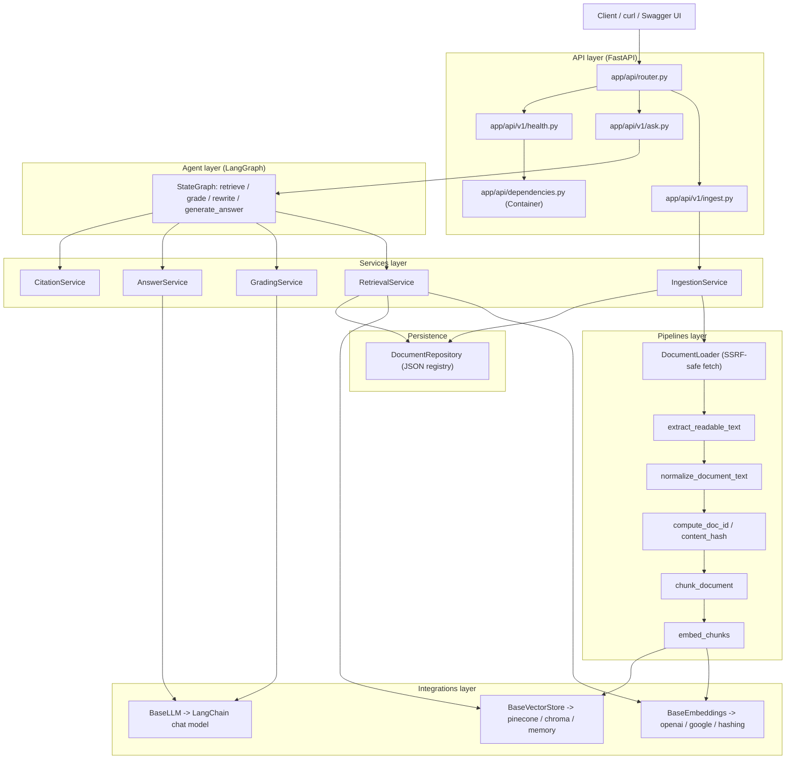
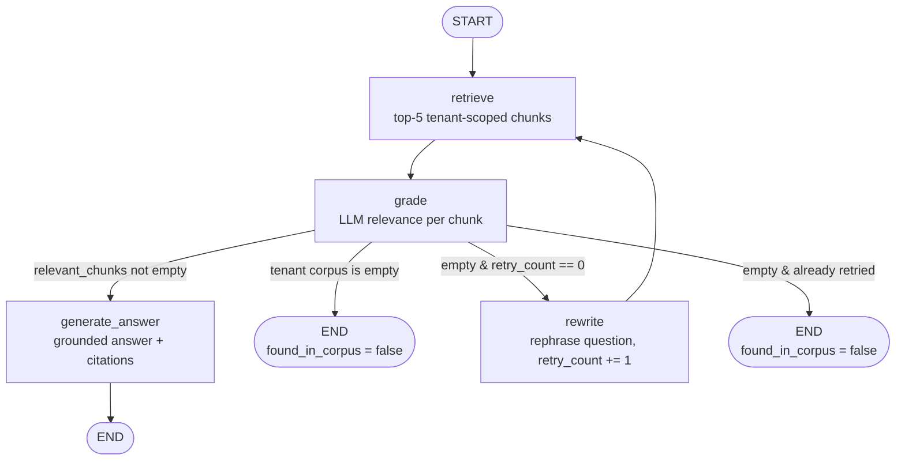
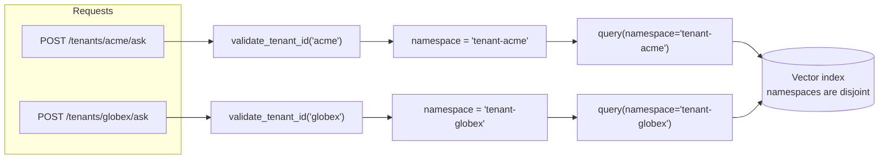

# 🏢 Brand Q&A Agent | 🤖✨

[](https://github.com/syed-sadain/Brand-Q-A-Agent-/actions/workflows/ci.yml)
[](https://www.python.org/)
[](https://fastapi.tiangolo.com/)
[](https://www.langchain.com/langgraph)
[](https://www.pinecone.io/)
[](https://docs.docker.com/compose/)
[](LICENSE)

A multi-tenant **Brand Q&A** backend: a Retrieval-Augmented Generation (RAG) service that ingests
web pages or raw text about brands, indexes them in a vector database, and answers natural-language
questions using **only** the ingested evidence — with citations and an execution trace.

The question-answering path is implemented as a **LangGraph `StateGraph`**: it retrieves and grades
evidence, answers when relevant evidence exists, and otherwise rewrites the question for at most one
retry. An empty tenant corpus ends without an LLM retry. Every tenant's data is isolated in its own
vector-store namespace, and answers are scoped to the tenant identified in the URL path.

---

## Quickstart

**One-command startup (Docker):**

```bash
docker compose up --build
```

Then open the interactive docs at <http://localhost:8000/docs> and check reachability at
<http://localhost:8000/health>.

**Local alternative (no Docker):**

```powershell
# Windows PowerShell
python -m venv .venv
.\.venv\Scripts\Activate.ps1
pip install -r requirements.txt
copy .env.example .env          # then edit .env and add your keys
uvicorn app.main:app --host 0.0.0.0 --port 8000 --reload
```

```bash
# POSIX
python -m venv .venv
source .venv/bin/activate
pip install -r requirements.txt
cp .env.example .env            # then edit .env and add your keys
uvicorn app.main:app --host 0.0.0.0 --port 8000 --reload
```

With the `Makefile` you can also run `make install` and `make run`. See
[Environment Setup](#13-environment-setup) and [Docker Startup](#15-docker-startup).

---

## 1. Project Overview

The Brand Q&A Agent is a small FastAPI backend that exposes three endpoints. It ingests documents
(URLs or raw text) about one or more brands, splits them into token-sized chunks, embeds the chunks,
and upserts them into a vector database **under a namespace derived from the tenant**. When asked a
question, it retrieves the most similar chunks for that tenant, asks the LLM to grade each chunk for
relevance, optionally rewrites the question and retries once, and finally produces a grounded answer
with citations back to the source chunks.

The service is designed to be honest: when the corpus does not contain the answer, it returns
`found_in_corpus: false`, an explicit "not available" message, and an empty citation list rather than
inventing an answer.

## 2. Business Problem

Marketing teams need to know how their brand appears in third-party content — review sites, "best
of" lists, comparison articles and company pages — and how it compares to competitors. The same
question asked to an AI assistant ("what is the best project-management tool for a small team?")
produces an answer assembled from exactly that kind of content.

This service is the retrieval-and-answering backend for that problem:

- It turns a corpus of brand-related pages into a searchable semantic index.
- It answers questions about that corpus **with references**, so results are auditable.
- It refuses to fabricate: if the evidence isn't there, it says so.
- It is **multi-tenant**: every customer's data is isolated so one customer can never see another's.

## 3. Key Features

- **Three endpoints**: `POST /tenants/{tenant_id}/ingest`, `POST /tenants/{tenant_id}/ask`, `GET /health`.
- **Multi-tenant isolation by design**: one namespace per tenant (`tenant-{tenant_id}`), enforced in the
  vector-store layer, with `tenant_id` also stored in every chunk's metadata.
- **Idempotent ingestion**: a stable SHA-256 `doc_id` plus `{doc_id}-{chunk_index}` vector ids mean
  re-ingesting the same document overwrites instead of duplicating.
- **Stale-vector cleanup**: when a document shrinks to fewer chunks, the leftover vectors are deleted
  using a JSON document registry that tracks each document's `chunk_count`.
- **LangGraph agent**: a real `StateGraph` with `retrieve`, `grade`, `rewrite` nodes, an answer node,
  a conditional edge and a genuine per-node `trace`.
- **Grounded answering with prompt-injection defence**: retrieved text is treated as untrusted data
  and wrapped in explicit `<<<EXCERPT ... EXCERPT>>>` delimiters.
- **Pluggable providers**: LLM (`openai` / `anthropic` / `google`), embeddings (`openai` / `google` /
  `hashing`) and vector store (`pinecone` / `chroma` / `memory`) are selected by environment variables.
- **SSRF-safe URL fetching** with per-redirect-hop re-validation, a content-type allow-list, a size
  limit and a timeout.
- **Consistent error handling**: an `AppError` hierarchy with stable `code`s and HTTP statuses, and a
  single `ErrorResponse` envelope.
- **Honest health checks**: `GET /health` performs real reachability probes against the vector store,
  embeddings and LLM rather than reporting "healthy" because a client object was constructed.
- **Structured logging** (console or JSON) with an `X-Request-ID` correlation header.

## 4. Technology Stack

| Area | Choice |
| --- | --- |
| Language | Python 3.11+ |
| Web framework | FastAPI (async ASGI) with Uvicorn |
| Validation / settings | Pydantic v2 and `pydantic-settings` |
| Agent framework | LangGraph (`StateGraph`) |
| LLM / text tooling | LangChain chat models (`langchain-openai`, `langchain-anthropic`, `langchain-google-genai`) and `langchain-text-splitters` (`RecursiveCharacterTextSplitter`) |
| Vector database | Pinecone (primary), ChromaDB (optional local), in-memory store (dev/test) |
| HTTP client | `httpx` (async, streaming) |
| HTML extraction | BeautifulSoup4 with the `lxml` parser |
| Tokenisation | `tiktoken` (with a character heuristic fallback) |
| Testing | Pytest + `pytest-asyncio` |
| Linting / typing | Ruff, MyPy |
| Packaging / run | Docker + Docker Compose, Makefile |

### Estimated operating budget

The estimates below use the OpenAI defaults in `.env.example` and are in **USD**, before tax. API
prices can change; the linked provider pages are the source of truth. This is a usage estimate, not a
hosting quote.

| Component | Pricing basis | Example cost |
| --- | --- | ---: |
| Chat model (`gpt-4o-mini`) | $0.15 / 1M input tokens; $0.60 / 1M output tokens | About **$0.90 per 1,000 asks** at 4,000 input + 500 output tokens per ask |
| Embeddings (`text-embedding-3-small`) | $0.02 / 1M input tokens | **$0.02 per 1M indexed/query tokens** |
| Chroma, local development | Local persistent store; no separate service charge | **$0** software fee; machine and storage excluded |
| Pinecone, managed option | Starter has included usage; Builder is $20/month; Standard has a $50/month minimum | Depends on plan and usage |
| API hosting | No hosting provider is selected by this repository | Not included |

The ask estimate assumes one retrieval/grading pass and excludes retries, taxes, hosting, and any
provider minimums. Off-topic questions can use the bounded rewrite/retry path and therefore cost more.
Measure actual token usage before setting a production budget. The `.env.example` chat model is
deprecated by its provider; select a currently supported model in `LLM_MODEL` before its announced
retirement on **2027-01-14**.

Price references: [OpenAI GPT-4o mini](https://developers.openai.com/api/docs/models/gpt-4o-mini),
[OpenAI text-embedding-3-small](https://developers.openai.com/api/docs/models/text-embedding-3-small),
[OpenAI deprecations](https://developers.openai.com/api/docs/deprecations), and
[Pinecone plans](https://www.pinecone.io/pricing/). Prices checked **2026-11-06**.

## 5. Architecture Overview

The application is layered. Each layer only depends on the layer beneath it; business logic depends on
abstractions, and concrete providers are assembled by factories at the edge.



Key properties:

- **Dependency injection**: `app/api/dependencies.py` defines a process-wide `Container` that lazily
  builds and caches the LLM, embeddings, vector store, repository, ingestion service and agent. Routes
  depend on small `Depends` callables so tests can override them.
- **No provider leakage**: services and graph nodes talk only to `BaseLLM`, `BaseEmbeddings` and
  `BaseVectorStore`; concrete SDKs live behind factories.
- **Security is enforced at multiple layers**: tenant validation and SSRF checks live in
  `app/core/security.py` and the vector-store adapters, not only in the route handlers.

See [`docs/ARCHITECTURE.md`](docs/ARCHITECTURE.md) for the full component breakdown and extension points.

## 6. Folder Structure

```text
brand-qa-agent/
├── .github/
│   └── workflows/
│       └── ci.yml                      # lint, type-check and test on GitHub Actions
├── app/
│   ├── __init__.py                     # __version__ = "1.0.0"
│   ├── main.py                         # FastAPI app factory + lifespan
│   ├── api/
│   │   ├── __init__.py
│   │   ├── router.py                   # aggregates the v1 route modules
│   │   ├── dependencies.py             # Container + FastAPI Depends callables
│   │   └── v1/
│   │       ├── __init__.py
│   │       ├── ingest.py               # POST /tenants/{tenant_id}/ingest
│   │       ├── ask.py                  # POST /tenants/{tenant_id}/ask
│   │       └── health.py               # GET /health
│   ├── core/
│   │   ├── __init__.py
│   │   ├── config.py                   # pydantic-settings Settings
│   │   ├── exceptions.py               # AppError hierarchy
│   │   ├── logging.py                  # console / JSON structured logging
│   │   ├── middleware.py               # request-id middleware + exception handlers
│   │   └── security.py                 # tenant validation, namespacing, SSRF checks
│   ├── agents/
│   │   ├── __init__.py
│   │   ├── brand_qa_agent.py           # BrandQAAgent: builds graph + wires services
│   │   ├── graph_builder.py            # StateGraph assembly + compile
│   │   ├── graph_state.py              # GraphState TypedDict + GraphDependencies
│   │   ├── edges/
│   │   │   ├── __init__.py
│   │   │   └── conditional_edges.py    # route_after_grade + ANSWER_NODE name
│   │   └── nodes/
│   │       ├── __init__.py
│   │       ├── retrieve_node.py
│   │       ├── grade_node.py
│   │       ├── rewrite_node.py
│   │       └── answer_node.py
│   ├── services/
│   │   ├── __init__.py
│   │   ├── ingestion_service.py        # load → chunk → embed → upsert → register
│   │   ├── retrieval_service.py        # tenant-scoped semantic search
│   │   ├── grading_service.py          # LLM relevance grading
│   │   ├── answer_service.py           # grounded answering + rewriting
│   │   ├── citation_service.py         # citation construction + NOT_FOUND_ANSWER
│   │   └── prompts.py                  # prompt templates (untrusted-data delimiters)
│   ├── pipelines/
│   │   ├── __init__.py
│   │   ├── document_loader.py          # URL/raw-text loading, SSRF-safe fetch
│   │   ├── text_extractor.py           # HTML → readable text (BeautifulSoup + lxml)
│   │   ├── text_normalizer.py          # whitespace + boilerplate stripping
│   │   ├── document_hasher.py          # content_hash + compute_doc_id (SHA-256)
│   │   ├── document_chunker.py         # RecursiveCharacterTextSplitter, token-aware
│   │   └── embedding_pipeline.py       # chunks → VectorRecord (embeds + metadata)
│   ├── integrations/
│   │   ├── __init__.py
│   │   ├── llm/
│   │   │   ├── __init__.py
│   │   │   ├── base.py                 # BaseLLM, LLMMessage, GradingDecision
│   │   │   ├── factory.py              # build_llm(settings)
│   │   │   └── providers.py            # LangChainLLM adapter
│   │   ├── embeddings/
│   │   │   ├── __init__.py
│   │   │   ├── base.py                 # BaseEmbeddings
│   │   │   ├── factory.py              # build_embeddings(settings)
│   │   │   └── providers.py            # LangChainEmbeddings, HashingEmbeddings
│   │   └── vectorstores/
│   │       ├── __init__.py
│   │       ├── base.py                 # BaseVectorStore, VectorRecord, VectorMatch
│   │       ├── factory.py              # build_vector_store(settings)
│   │       ├── memory_store.py         # InMemoryVectorStore
│   │       ├── chroma_store.py         # ChromaVectorStore (one collection per tenant)
│   │       └── pinecone_store.py       # PineconeVectorStore (one namespace per tenant)
│   ├── repositories/
│   │   ├── __init__.py
│   │   └── document_repository.py      # JSON document registry (chunk_count tracking)
│   ├── schemas/
│   │   ├── __init__.py
│   │   ├── common.py                   # ErrorResponse
│   │   ├── ingest.py                   # IngestRequest / IngestResponse / IngestError
│   │   ├── ask.py                      # AskRequest / AskResponse
│   │   ├── citation.py                 # Citation / TraceEntry
│   │   └── health.py                   # HealthResponse / ComponentHealth
│   ├── models/
│   │   ├── __init__.py
│   │   └── document.py                 # LoadedDocument / DocumentChunk / RetrievedChunk
│   └── utils/
│       ├── __init__.py
│       ├── text_utils.py               # normalise/token-count/truncate helpers
│       ├── validators.py               # brand normalisation, usable-text checks
│       └── retry.py                    # bounded async retry with backoff
├── scripts/
│   ├── ingest_sample_data.py           # bulk-ingest the sample corpus (offline, or --api)
│   └── verify_environment.py           # check Python, dependencies and config before running
├── data/
│   ├── README.md                       # notes about the sample corpus (synthetic test data)
│   └── sample_documents/               # synthetic sample corpus used for local demos
├── tests/
│   ├── conftest.py                     # shared fixtures (fake LLM, in-memory store, client)
│   ├── unit/
│   ├── integration/
│   ├── security/
│   │   └── test_tenant_isolation.py    # mandatory test #1
│   └── agent/
│       └── test_graph_workflow.py      # mandatory test #2
├── docs/
│   ├── ARCHITECTURE.md
│   ├── API_DOCUMENTATION.md
│   ├── INGESTION_PIPELINE.md
│   ├── LANGGRAPH_WORKFLOW.md
│   ├── SECURITY.md
│   └── DESIGN_DECISIONS.md
├── .env.example
├── docker-compose.yml
├── Dockerfile
├── Makefile
├── pyproject.toml                      # Ruff / MyPy / Pytest configuration
├── requirements.txt
├── README.md
├── LICENSE
└── VIDEO_WALKTHROUGH.md
```

## 7. Ingestion Workflow

`POST /tenants/{tenant_id}/ingest` runs the pipeline below. See
[`docs/INGESTION_PIPELINE.md`](docs/INGESTION_PIPELINE.md) for the full detail.

```mermaid
flowchart LR
    A["1. Load<br/>load url (SSRF-safe) or raw text"] --> B["2. Extract<br/>HTML → readable text"]
    B --> C["3. Normalise<br/>whitespace + boilerplate"]
    C --> D["4. Validate<br/>minimum usable text"]
    D --> E["5. Hash<br/>content_hash + stable doc_id"]
    E --> F["6. Chunk<br/>RecursiveCharacterTextSplitter (400/50 tokens)"]
    F --> G["7. Embed<br/>aembed_documents"]
    G --> H["8. Upsert<br/>ids {doc_id}-{chunk_index}, namespace tenant-{id}"]
    H --> I["9. Register<br/>doc_id, chunk_count in JSON registry"]
    I --> J["10. Clean stale<br/>delete obsolete chunk ids"]
```



Highlights:

- **Stable identity**: `doc_id = SHA-256(tenant_id + "::" + (url | text::content_hash))`. URL documents are
  keyed on their normalised URL; raw-text documents on the hash of their normalised content.
- **Overwrite, not duplicate**: vector ids are `{doc_id}-{chunk_index}`, so a re-ingest upserts over the
  same ids and the stored count does not grow.
- **Obsolete-chunk removal**: if a document now produces *fewer* chunks than before, the registry's
  stored `chunk_count` lets the service delete the trailing ids.
- **Per-document failure isolation**: documents are processed concurrently under a bounded semaphore;
  one failure is recorded in `errors` without aborting the batch.
- **Safe fetching**: per-redirect-hop SSRF re-validation, a text content-type allow-list, a byte-size
  limit and a timeout.

## 8. LangGraph Workflow

`POST /tenants/{tenant_id}/ask` runs a compiled `StateGraph`. See
[`docs/LANGGRAPH_WORKFLOW.md`](docs/LANGGRAPH_WORKFLOW.md) for the state schema and node details.



- **`retrieve`** embeds the active question (the rewritten one during a retry, else the original) and
  queries the tenant's namespace for the top `RETRIEVAL_TOP_K` chunks.
- **`grade`** asks the LLM, per chunk, whether it helps answer the **original** question, keeping the
  "relevant" chunks. Grading failures are counted as rejected; an `LLMError` is raised only if **all**
  gradings fail.
- **The conditional edge** (`route_after_grade`): relevant chunks → answer; an empty tenant corpus →
  end immediately; otherwise, if `retry_count == 0`, rewrite and retry once; after that, end with
  `found_in_corpus = false`.
- **The answer node** is registered as `generate_answer` because LangGraph reserves state-field names
  as node names and `answer` is a state field. The trace label it writes is still `answer`.
- **The trace is real**: `trace` uses `Annotated[list[TraceEntry], operator.add]`, so each node
  *appends* its own entry rather than overwriting it.

## 9. Tenant Isolation Strategy

Tenant isolation is enforced **in depth**: at the API boundary, in the derived namespace, and inside
the vector-store adapters.



- **Validated id**: the tenant id is validated against
  `^[a-z0-9](?:[a-z0-9_-]{0,62}[a-z0-9])?$` (1–64 chars, lower-cased), which also prevents namespace
  injection.
- **Namespace per tenant**: `tenant_namespace()` returns `tenant-{tenant_id}`. Pinecone uses namespaces;
  Chroma uses one collection per tenant; the in-memory store uses one dictionary per namespace.
- **Mandatory scope**: `BaseVectorStore.query(namespace, ...)` requires a namespace. There is **no API
  for a global or cross-tenant search**. An optional `metadata_filter` can only *narrow* results within
  the tenant namespace — it can never widen the search.
- **Tenant in metadata**: every chunk's metadata includes `tenant_id`, so data provenance is explicit
  and auditable even within a namespace.

## 10. Vector Database Design

| Concern | Design |
| --- | --- |
| Primary backend | Pinecone, with one **namespace per tenant** and cosine similarity |
| Optional local backend | ChromaDB, with **one collection per tenant** and cosine HNSW space |
| Dev/test backend | In-memory store, **one dictionary keyed by namespace** |
| Namespace | `tenant-{tenant_id}` derived from the validated tenant id |
| Vector id | `{doc_id}-{chunk_index}` |
| Upsert batching | Pinecone upserts in batches of 100 (constant `_PINECONE_UPSERT_BATCH`) |
| Similarity | Cosine in all backends (Chroma scores are reported as `1 - distance`) |
| Delete | By id within a namespace, used only for obsolete-chunk cleanup |
| Health | Pinecone: `has_index` + `describe_index_stats`; Chroma: `heartbeat`; memory: always healthy |

Chunk metadata stored alongside each vector:

```json
{
  "tenant_id": "acme",
  "doc_id": "483f254fe3e9935cf563ebc16ec90440600ddc6beac357c96a5c9852fcb89470",
  "chunk_index": 0,
  "source": "https://example.com/best-pm-tools-2026",
  "brand": "Asana",
  "content_hash": "54e489e56434bf51f4665d708fe217c79734b522e31ec6dc5af980b6c7921c2e",
  "text": "…the verbatim chunk text, stored so citations need no second fetch…"
}
```

## 11. API Endpoints

| Method | Path | Purpose |
| --- | --- | --- |
| `POST` | `/tenants/{tenant_id}/ingest` | Ingest URL-based or raw-text documents for a tenant |
| `POST` | `/tenants/{tenant_id}/ask` | Ask a question about a tenant's corpus |
| `GET` | `/health` | Report dependency reachability (always HTTP 200) |

- Interactive docs: `/docs` (Swagger UI) and `/redoc` (ReDoc).
- OpenAPI schema: `/openapi.json`.
- Errors use a single envelope: `{"code": str, "message": str, "details"?: object}`.

Full schemas, field tables and every error code are in
[`docs/API_DOCUMENTATION.md`](docs/API_DOCUMENTATION.md).

## 12. Request/Response Examples

### Ingest — URL-based

```bash
curl -X POST http://localhost:8000/tenants/acme/ingest \
  -H "Content-Type: application/json" \
  -d '{
        "documents": [
          {"url": "https://example.com/best-pm-tools-2026", "brand": "Asana"}
        ]
      }'
```

### Ingest — raw text

```bash
curl -X POST http://localhost:8000/tenants/acme/ingest \
  -H "Content-Type: application/json" \
  -d '{
        "documents": [
          {
            "text": "Reviewers say Asana is powerful but pricier per seat than Trello, which offers a generous free tier.",
            "source": "manual-1",
            "brand": "Trello"
          }
        ]
      }'
```

Response:

```json
{
  "documents_stored": 1,
  "chunks_stored": 1,
  "errors": []
}
```

### Ask — normal question (answer + citations + trace)

Request:

```bash
curl -X POST http://localhost:8000/tenants/acme/ask \
  -H "Content-Type: application/json" \
  -d '{"question": "What do reviewers say about Asana pricing compared to Trello?"}'
```

Response:

```json
{
  "answer": "Reviewers generally describe Asana as more powerful for complex workflows but pricier per seat, while Trello is noted as better value for small teams and offers a generous free tier.",
  "found_in_corpus": true,
  "citations": [
    {
      "source": "https://example.com/best-pm-tools-2026",
      "brand": "Asana",
      "chunk_text": "Reviewers frequently note that Asana's per-seat pricing becomes expensive for larger teams, while Trello offers a generous free tier and cheaper paid plans."
    }
  ],
  "trace": [
    {"node": "retrieve", "detail": "5 chunks retrieved"},
    {"node": "grade", "detail": "3 relevant, 2 rejected"},
    {"node": "answer", "detail": "Answer generated from 3 relevant chunks"}
  ]
}
```

### Ask — question the corpus cannot answer (rewrite + retry + not-found)

Request:

```bash
curl -X POST http://localhost:8000/tenants/acme/ask \
  -H "Content-Type: application/json" \
  -d '{"question": "What is the capital of France?"}'
```

Response:

```json
{
  "answer": "The requested information is not available in the provided documents.",
  "found_in_corpus": false,
  "citations": [],
  "trace": [
    {"node": "retrieve", "detail": "5 chunks retrieved"},
    {"node": "grade", "detail": "0 relevant, 5 rejected"},
    {"node": "rewrite", "detail": "Question rewritten and retry #1 scheduled"},
    {"node": "retrieve", "detail": "5 chunks retrieved"},
    {"node": "grade", "detail": "0 relevant, 5 rejected"}
  ]
}
```

### Health

```bash
curl http://localhost:8000/health
```

```json
{
  "status": "healthy",
  "app_env": "local",
  "version": "1.0.0",
  "components": {
    "vector_store": {"status": "healthy", "provider": "memory", "detail": "in-memory store", "latency_ms": 0.02},
    "embeddings": {"status": "healthy", "provider": "hashing", "detail": "local deterministic embeddings", "latency_ms": 0.01},
    "llm": {"status": "healthy", "provider": "openai", "detail": null, "latency_ms": 142.5}
  }
}
```

Overall status rules: `unavailable` if the **vector store** is unavailable; `degraded` if the vector
store is not unavailable but some component is not healthy; otherwise `healthy`. The endpoint always
returns HTTP 200.

## 13. Environment Setup

Configuration is read from environment variables, optionally via a local `.env` file
(`.env.example` documents the full set). **Never commit real keys.**

| Variable | Default | Description |
| --- | --- | --- |
| `APP_NAME` | `Brand Q&A Agent` | Human-readable application name (OpenAPI title). |
| `APP_ENV` | `local` | One of `local`, `development`, `staging`, `production`, `test`. |
| `APP_DEBUG` | `false` | Debug behaviour; never enable in production. |
| `API_VERSION` | `v1` | Active API version label. |
| `LLM_PROVIDER` | `openai` | Chat LLM provider: `openai`, `anthropic`, `google`. |
| `LLM_MODEL` | `gpt-4o-mini` | Chat model identifier. |
| `LLM_API_KEY` | *(unset)* | Generic LLM key. Falls back to `OPENAI_API_KEY` / `ANTHROPIC_API_KEY` / `GOOGLE_API_KEY`. |
| `LLM_TEMPERATURE` | `0.0` | Sampling temperature (0.0–2.0). |
| `LLM_TIMEOUT` | `30.0` | LLM request timeout, seconds. |
| `LLM_MAX_RETRIES` | `2` | SDK-level retries (0–5). |
| `EMBEDDING_PROVIDER` | `openai` | `openai`, `google` or `hashing`. |
| `EMBEDDING_MODEL` | `text-embedding-3-small` | Embedding model id. |
| `EMBEDDING_API_KEY` | *(unset)* | Embedding key; falls back to the LLM key / provider env var. |
| `EMBEDDING_DIMENSION` | `1536` | Vector dimension; **must match the index dimension**. |
| `PINECONE_API_KEY` | *(unset)* | Required when `VECTOR_STORE_PROVIDER=pinecone`. |
| `PINECONE_INDEX_NAME` | `brand-qa-agent` | Index name (created on first use if missing). |
| `PINECONE_CLOUD` | `aws` | Serverless cloud for index creation. |
| `PINECONE_REGION` | `us-east-1` | Serverless region for index creation. |
| `VECTOR_STORE_PROVIDER` | `memory` | `pinecone`, `chroma` or `memory`. |
| `CHROMA_PERSIST_DIR` | `./.chroma` | Chroma persistence directory. |
| `CHUNK_SIZE` | `400` | Chunk size **in tokens**. |
| `CHUNK_OVERLAP` | `50` | Chunk overlap **in tokens** (must be `< CHUNK_SIZE`). |
| `RETRIEVAL_TOP_K` | `5` | Chunks retrieved per query (1–50). |
| `HTTP_TIMEOUT` | `15.0` | Outbound fetch timeout, seconds. |
| `HTTP_MAX_BYTES` | `5000000` | Maximum bytes downloaded per URL. |
| `HTTP_MAX_REDIRECTS` | `5` | Maximum redirects followed (0–10). |
| `HTTP_USER_AGENT` | `BrandQAAgent/1.0 (+https://example.com/bot)` | User-Agent for outbound fetches. |
| `LOG_LEVEL` | `INFO` | Log level (upper-cased automatically). |
| `LOG_JSON` | `false` | Emit single-line JSON logs instead of console logs. |
| `ALLOW_PRIVATE_NETWORKS` | `false` | Allow private/reserved IPs (local testing only). |
| `DOCUMENT_REGISTRY_PATH` | `./.data/document_registry.json` | JSON registry for stale-chunk cleanup. |

Additional settings used by the server and tooling: `HOST` (default `0.0.0.0`) and `PORT` (default
`8000`), and `ALLOWED_URL_SCHEMES` (default `http,https`).

## 14. Installation Instructions

```powershell
# Windows PowerShell
python -m venv .venv
.\.venv\Scripts\Activate.ps1
pip install -r requirements.txt
copy .env.example .env
```

```bash
# POSIX
python -m venv .venv
source .venv/bin/activate
pip install -r requirements.txt
cp .env.example .env
```

Run the development server:

```bash
uvicorn app.main:app --host 0.0.0.0 --port 8000 --reload
```

`pyproject.toml` carries the Ruff, MyPy and Pytest configuration. The optional Chroma backend requires
installing `chromadb`; it is imported lazily and is not needed for the Pinecone or in-memory backends.

## 15. Docker Startup

The project ships a `Dockerfile` and `docker-compose.yml` so the whole service starts with a single
command:

```bash
docker compose up --build
```

The service is then reachable at <http://localhost:8000>. Configure providers through the environment
(shell variables or a `.env` file that Compose reads). Useful variants:

```bash
# Run in the background
docker compose up --build -d

# Follow logs
docker compose logs -f

# Stop and remove containers
docker compose down
```

## 16. Sample Ingestion Instructions

The repository ships a **synthetic sample corpus** under `data/sample_documents/` (deliberately labelled
test data — see [Known Limitations](#19-known-limitations)). A helper script
`scripts/ingest_sample_data.py` bulk-ingests that corpus for a tenant.

Ingest the sample corpus for tenant `acme`:

```powershell
# Offline, in-process (no API key and no running server required)
.\.venv\Scripts\python.exe scripts\ingest_sample_data.py --tenant acme

# Or against a locally running server
.\.venv\Scripts\python.exe scripts\ingest_sample_data.py --tenant acme --api --base-url http://localhost:8000
```

If you prefer plain HTTP, ingest a single raw-text document:

```bash
curl -X POST http://localhost:8000/tenants/acme/ingest \
  -H "Content-Type: application/json" \
  -d '{
        "documents": [
          {
            "text": "Reviewers say Asana is powerful but pricier per seat than Trello, which offers a generous free tier.",
            "source": "manual-1",
            "brand": "Asana"
          }
        ]
      }'
```

Re-run the same request to confirm idempotency:

```bash
curl -X POST http://localhost:8000/tenants/acme/ingest \
  -H "Content-Type: application/json" \
  -d '{
        "documents": [
          {
            "text": "Reviewers say Asana is powerful but pricier per seat than Trello, which offers a generous free tier.",
            "source": "manual-1",
            "brand": "Asana"
          }
        ]
      }'
# documents_stored: 1, chunks_stored: 1  (same values — the document is overwritten, not duplicated)
```

## 17. API Testing Instructions

1. Start the service (`docker compose up --build` or `uvicorn app.main:app --reload`).
2. Open Swagger UI at <http://localhost:8000/docs> to try requests interactively, or use `curl`.
3. Ingest documents (§16), then ask a question:

```bash
curl -X POST http://localhost:8000/tenants/acme/ask \
  -H "Content-Type: application/json" \
  -d '{"question": "What do reviewers say about Asana pricing compared to Trello?"}'
```

Error cases to exercise:

```bash
# Invalid tenant id  -> 400 invalid_tenant_id
curl -X POST http://localhost:8000/tenants/Acme!/ask \
  -H "Content-Type: application/json" -d '{"question": "hi"}'

# Invalid payload (both url and text) -> 422 request_validation_error
curl -X POST http://localhost:8000/tenants/acme/ingest \
  -H "Content-Type: application/json" \
  -d '{"documents": [{"url": "https://example.com", "text": "x", "brand": "Asana"}]}'
```

Every response carries an `X-Request-ID` header for correlation with the server logs.

## 18. Pytest Execution

Run the whole test-suite (the LLM is mocked, so **no API key is required**):

```bash
pytest -q
```

Run only the two **mandatory** assignment tests (tenant isolation and decision logic):

```powershell
.venv\Scripts\python.exe -m pytest tests/security/test_tenant_isolation.py tests/agent/test_graph_workflow.py -v
```

With the Makefile:

```bash
make test        # run the test suite
make lint        # Ruff
make format      # Ruff format
make typecheck   # MyPy
```

### Make targets

| Target | Purpose |
| --- | --- |
| `make install` | Create/refresh the environment and install dependencies. |
| `make run` | Start the Uvicorn development server. |
| `make test` | Run the Pytest suite. |
| `make lint` | Run Ruff lint checks. |
| `make format` | Apply Ruff formatting. |
| `make typecheck` | Run MyPy type checks. |
| `make clean` | Remove caches and temporary artefacts. |

## 19. Known Limitations

- **The sample corpus is synthetic.** The documents under `data/sample_documents/` are deliberately
  authored test data (not real articles) and are labelled as such. They exist to make local demos and
  tests reproducible.
- **`hashing` embeddings are not a real model.** The `hashing` embedding provider is a deterministic
  offline feature-hashing (bag-of-words) implementation used for development and tests. It captures
  lexical overlap only and is **not semantically equivalent** to a real embedding model — do not use it
  in production.
- **The in-memory vector store is process-local.** Data indexed with `VECTOR_STORE_PROVIDER=memory`
  lives in the process and is lost on restart; it is intended for dev/test, not for serving production
  traffic.
- **The document registry is a local JSON file.** Stale-chunk cleanup relies on
  `DOCUMENT_REGISTRY_PATH` (a single JSON file). Writes use atomic replacement where supported and
  fall back to an in-place write on managed Windows/OneDrive folders that deny directory replacement.
  It is not shared across processes or hosts, so on a multi-replica deployment the tracking would need
  a database or cache instead.
- **Single-process retry semantics.** The one-retry decision uses the graph's own `retry_count` within a
  single request; it is not a distributed job-queue retry mechanism.
- **No authentication layer.** `tenant_id` is taken from the URL path; the service does not authenticate
  callers, so any client that can reach the API can address any tenant id. **Authentication and
  authorisation would be required in production** (e.g. API keys or OAuth scopes mapping a caller to an
  allowed tenant set), together with rate limiting and audit logging.
- **Grading cost and latency scale with top-k.** Grading calls the LLM once per retrieved chunk; a
  larger `RETRIEVAL_TOP_K` increases both latency and cost.

## 20. Future Improvements

- **Authentication and authorisation**: API keys / OAuth with per-caller tenant scoping, plus rate
  limiting and audit logging.
- **Shared registry**: move stale-chunk tracking from the JSON file to Postgres/Redis for multi-replica
  deployments.
- **Reranking**: add a cross-encoder or LLM reranker between retrieval and grading to reduce grade calls.
- **Streaming answers**: stream `generate_answer` tokens via SSE for a better UX.
- **Hybrid search**: combine dense vectors with BM25/keyword retrieval and fuse the results.
- **Metadata filtering**: expose an optional `metadata_filter` (e.g. by brand) on `/ask`.
- **Observability**: metrics and tracing (e.g. OpenTelemetry) for per-node latency and provider error
  rates.
- **Corpus refresh**: scheduled re-ingestion with change detection based on `content_hash`.

---

## Further documentation

| Document | Contents |
| --- | --- |
| [`docs/ARCHITECTURE.md`](docs/ARCHITECTURE.md) | Layered architecture, DI, data flow, extension points |
| [`docs/API_DOCUMENTATION.md`](docs/API_DOCUMENTATION.md) | Endpoint reference, schemas, error codes, curl examples |
| [`docs/INGESTION_PIPELINE.md`](docs/INGESTION_PIPELINE.md) | Step-by-step ingestion, metadata, idempotency |
| [`docs/LANGGRAPH_WORKFLOW.md`](docs/LANGGRAPH_WORKFLOW.md) | Graph state, nodes, routing, trace |
| [`docs/SECURITY.md`](docs/SECURITY.md) | Tenant isolation, SSRF, prompt injection, hygiene |
| [`docs/DESIGN_DECISIONS.md`](docs/DESIGN_DECISIONS.md) | Trade-offs and rationale |
| [`VIDEO_WALKTHROUGH.md`](VIDEO_WALKTHROUGH.md) | 10–12 minute demo script |
