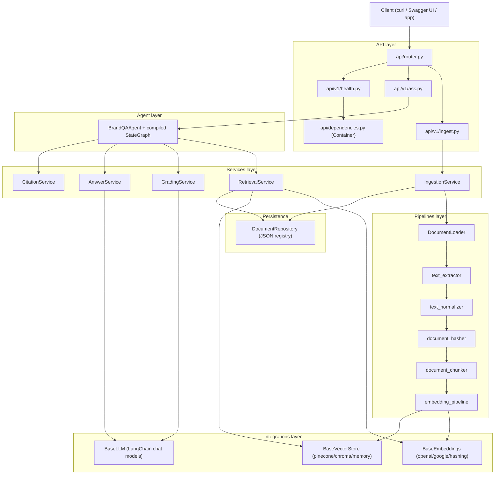
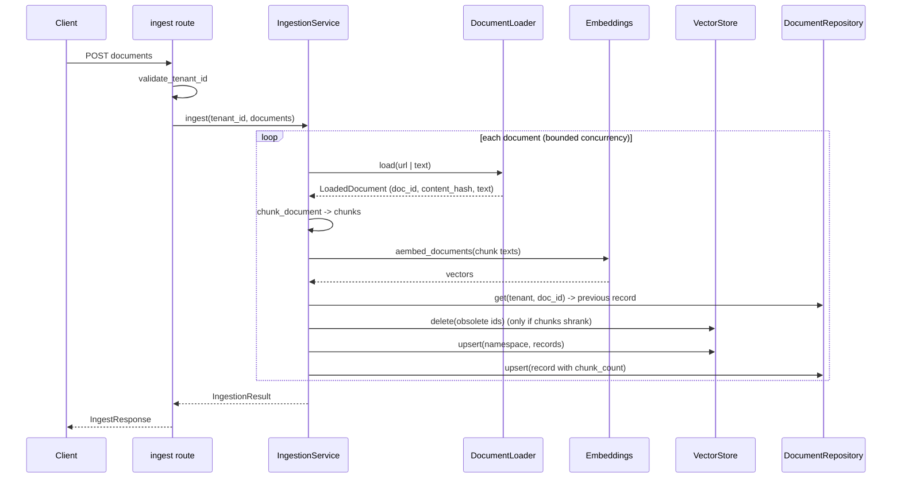
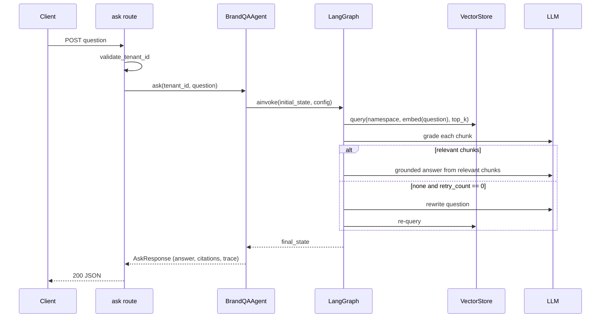

# Architecture

This document describes the layered architecture of the Brand Q&A Agent, the responsibilities of each
component, how dependencies are injected, how data flows through the system, and where to extend it.

---

## 1. Layered design

The codebase is organised into strict layers. A layer may depend on the layers below it, never on the
layers above it. Business logic depends on **abstractions** (`BaseLLM`, `BaseEmbeddings`,
`BaseVectorStore`), and concrete providers are created by factories at the edges.



| Layer | Location | Responsibility |
| --- | --- | --- |
| API | `app/api/` | HTTP concerns only: routing, path-param validation, dependency injection, response shaping. |
| Services | `app/services/` | Business logic: ingestion orchestration, retrieval, grading, answering, citations, prompts. |
| Agent | `app/agents/` | The LangGraph workflow: state, nodes, conditional edges, graph assembly. |
| Pipelines | `app/pipelines/` | Pure, composable document transformations (load → extract → normalise → hash → chunk → embed). |
| Integrations | `app/integrations/` | Provider adapters behind abstract interfaces, plus their factories. |
| Persistence | `app/repositories/` | The document registry that drives idempotency and stale-chunk cleanup. |
| Core | `app/core/` | Cross-cutting concerns: settings, exceptions, logging, middleware, security helpers. |
| Schemas / Models | `app/schemas/`, `app/models/` | Pydantic request/response models and internal dataclasses. |

## 2. Component responsibilities

### `app/main.py`
Builds the `FastAPI` application (`create_app()`), configures logging, attaches the request-context
middleware, registers exception handlers, includes the aggregate router, and defines the `lifespan`
that logs provider configuration at startup. The ASGI object is `app = create_app()`.

### `app/api/`
- **`router.py`** aggregates `health`, `ingest` and `ask` routers into `api_router`.
- **`v1/ingest.py`** validates the tenant id, delegates to `IngestionService`, and maps the internal
  `IngestionResult` onto `IngestResponse`.
- **`v1/ask.py`** validates the tenant id and delegates to `BrandQAAgent.ask()`.
- **`v1/health.py`** probes the vector store, embeddings and LLM and folds the results into an overall
  status.
- **`dependencies.py`** defines the `Container` (lazy, cached providers) and the `Depends` callables
  used by the routes.

### `app/core/`
- **`config.py`** — `Settings` (pydantic-settings), loaded from env/`.env`, with cross-field validation
  (`CHUNK_OVERLAP < CHUNK_SIZE`) and API-key resolution helpers.
- **`exceptions.py`** — the `AppError` hierarchy; every error maps to a stable `code` and an HTTP
  `status_code`.
- **`logging.py`** — `configure_logging()` plus `JsonFormatter`/`ConsoleFormatter` and the
  `request_id_ctx` context variable.
- **`middleware.py`** — `RequestContextMiddleware` (correlation id, timing, request logging) and
  `register_exception_handlers()`.
- **`security.py`** — `validate_tenant_id`, `tenant_namespace`, and the SSRF-safe URL validation
  functions (`validate_url_async`, `validate_url_sync`).

### `app/agents/`
- **`graph_state.py`** — `GraphState` (`TypedDict, total=False`) and `GraphDependencies`, plus
  `dependencies_from_config()` which pulls injected services out of the runnable config.
- **`graph_builder.py`** — assembles and compiles the `StateGraph`.
- **`edges/conditional_edges.py`** — `route_after_grade()` and the `ANSWER_NODE = "generate_answer"`
  constant.
- **`nodes/`** — `retrieve_node`, `grade_node`, `rewrite_node`, `answer_node`.
- **`brand_qa_agent.py`** — `BrandQAAgent` builds the graph, wires services, runs `ainvoke`, and
  post-processes the final state into an `AskResponse`.

### `app/services/`
- **`ingestion_service.py`** — orchestrates load → chunk → embed → upsert → register → cleanup, with
  bounded concurrency and per-document failure isolation.
- **`retrieval_service.py`** — embeds the question and queries the tenant namespace; raises
  `EmptyCorpusError` when the tenant has no documents and `VectorStoreError` on query failure.
- **`grading_service.py`** — grades each chunk via structured LLM output, preserving order and counting
  failures as rejections.
- **`answer_service.py`** — grounded answer generation and question rewriting.
- **`citation_service.py`** — builds citations from evidence; defines `NOT_FOUND_ANSWER`.
- **`prompts.py`** — system/user prompt templates, including the untrusted-data delimiters.

### `app/pipelines/`
Stateless transformation steps composed by the ingestion service (see
[INGESTION_PIPELINE.md](INGESTION_PIPELINE.md)).

### `app/integrations/`
Provider adapters with a shared abstract base per capability and a `build_*` factory that reads
`Settings`. See §5.

### `app/repositories/document_repository.py`
`DocumentRepository` is an async-safe JSON registry recording, per tenant/doc, the `chunk_count`. It
persists atomically (write-to-temp + `os.replace`) and supports an ephemeral, process-local mode when
constructed with `path=None` (used by tests).

## 3. Dependency injection

`app/api/dependencies.py` defines a `Container` that constructs shared, expensive objects **lazily** and
caches them per process:

```python
class Container:
    def llm(self) -> BaseLLM: ...  # build_llm(settings)
    def embeddings(self) -> BaseEmbeddings: ...
    def vector_store(self) -> BaseVectorStore: ...
    def repository(self) -> DocumentRepository: ...
    def ingestion_service(self) -> IngestionService: ...
    def agent(self) -> BrandQAAgent: ...
```

`get_container()` is cached with `functools.lru_cache`, so a single container (and therefore a single
agent, vector store, etc.) is shared for the process. Routes depend on small callables —
`get_ingestion_service_dep`, `get_agent_dep`, `get_container_dep` — which FastAPI can override in tests
via `app.dependency_overrides` without touching production code. The `Container.__init__` also accepts
pre-built `llm`, `embeddings`, `vector_store` and `repository` arguments for exactly this purpose.

Inside the graph, services are not looked up globally: `BrandQAAgent.build()` assembles a
`GraphDependencies` object and passes it through the runnable config
(`{"configurable": {"dependencies": deps}}`). Each node resolves it with `dependencies_from_config()`.

## 4. Data flow

### Ingestion (`POST /tenants/{tenant_id}/ingest`)



### Question answering (`POST /tenants/{tenant_id}/ask`)



## 5. Integrations and factories

| Capability | Interface | Factory | Implementations |
| --- | --- | --- | --- |
| Chat LLM | `app/integrations/llm/base.py::BaseLLM` | `build_llm(settings)` | `LangChainLLM` (OpenAI / Anthropic / Google chat models) |
| Embeddings | `app/integrations/embeddings/base.py::BaseEmbeddings` | `build_embeddings(settings)` | `LangChainEmbeddings` (OpenAI / Google), `HashingEmbeddings` |
| Vector store | `app/integrations/vectorstores/base.py::BaseVectorStore` | `build_vector_store(settings)` | `PineconeVectorStore`, `ChromaVectorStore`, `InMemoryVectorStore` |

Each factory reads only `Settings`, so switching providers is a configuration change, not a code change.
Provider SDKs are imported lazily inside the factories (and inside third-party adapters), which keeps
optional dependencies optional.

## 6. Cross-cutting concerns

- **Request correlation**: `RequestContextMiddleware` reads or generates an `X-Request-ID`, stores it in
  `request_id_ctx`, echoes it on the response, and logs method/path/status/duration for every request.
- **Error normalisation**: `AppError` subclasses carry `code`/`status_code`/`message`; handlers convert
  them (and `RequestValidationError`, and any uncaught `Exception`) into a single `ErrorResponse`
  envelope with no stack traces or secrets.
- **Configuration**: everything flows from `Settings`; there are no hard-coded credentials or model
  names.
- **Security**: tenant validation, namespacing and SSRF checks live in `app/core/security.py` so they are
  enforced close to the data layer. See [SECURITY.md](SECURITY.md).

## 7. Extension points

- **Add an LLM provider**: implement `BaseLLM` in `app/integrations/llm/providers.py` and add a branch to
  `build_llm` (extend the `LLMProvider` literal in `config.py`).
- **Add an embedding provider**: implement `BaseEmbeddings` in `app/integrations/embeddings/providers.py`
  and add a branch to `build_embeddings`.
- **Add a vector backend**: implement `BaseVectorStore` in `app/integrations/vectorstores/` and add a
  branch to `build_vector_store`. Honour the `namespace` argument in every method.
- **Add a graph node**: write the node in `app/agents/nodes/`, register it in `graph_builder.py`, and
  update `route_after_grade` if it changes routing. Keep the `trace` append pattern.
- **Change chunking**: adjust `CHUNK_SIZE`/`CHUNK_OVERLAP` or the separators in
  `app/pipelines/document_chunker.py`.
- **Swap the registry**: replace `DocumentRepository` with a database-backed implementation that keeps
  the same async API (`upsert`, `get`, `list_documents`, `count_documents`).
