# Ingestion Pipeline

This document describes what happens inside `POST /tenants/{tenant_id}/ingest`, from the incoming
request body to the vectors stored in the tenant's namespace.

The pipeline is orchestrated by `app/services/ingestion_service.py::IngestionService.ingest`, which
composes the stateless steps in `app/pipelines/`.

---

## Overview

```mermaid
flowchart LR
    Req["IngestRequest<br/>(1-100 documents)"] --> Sem["Bounded concurrency<br/>asyncio.Semaphore(4)"]

    Sem --> Load["1. Load<br/>DocumentLoader"]
    Load --> Extract["2. Extract<br/>BeautifulSoup + lxml"]
    Extract --> Normalise["3. Normalise<br/>whitespace + boilerplate"]
    Normalise --> Validate["4. Validate<br/>min usable text"]
    Validate --> Hash["5. Hash<br/>content_hash + doc_id"]
    Hash --> Chunk["6. Chunk<br/>RecursiveCharacterTextSplitter"]
    Chunk --> Embed["7. Embed<br/>aembed_documents"]
    Embed --> Cleanup["8a. Clean stale<br/>delete obsolete ids"]
    Cleanup --> Upsert["8b. Upsert<br/>namespace tenant-{id}"]
    Upsert --> Register["9. Register<br/>chunk_count in JSON registry"]
    Register --> Result["IngestResponse"]
```



Each document is processed independently: failures are captured per document and reported in
`errors`, while successes are counted in `documents_stored` / `chunks_stored`.

---

## Step 1 — Load (`app/pipelines/document_loader.py`)

`DocumentLoader.load(tenant_id, url=..., text=..., source=..., brand=...)` produces a `LoadedDocument`.

- **URL documents** are fetched with an async `httpx.AsyncClient` (connection-pooled, reused for the
  whole batch) and turned into text. The document's `<title>` is prepended when it is not already part
  of the extracted text.
- **Raw-text documents** use the supplied `text` directly. If `source` is omitted, the request model
  generates a stable label such as `manual-########`.

The loader is an async context manager so a single HTTP client (and its connection pool) is shared
across the batch:

```python
async with DocumentLoader(settings) as loader:
    document = await loader.load(tenant_id, url=..., brand=...)
```

### Security controls during fetch

| Control | Implementation |
| --- | --- |
| Scheme allow-list | Only `http` / `https` (`ALLOWED_URL_SCHEMES`). |
| Blocked hostnames | `localhost`, `*.localhost`, `*.local`, `metadata.google.internal`, `metadata.goog`. |
| Literal IP check | Direct IP literals in private/loopback/link-local/multicast/reserved/unspecified ranges are rejected. |
| DNS re-resolution | The hostname is resolved and **every** resolved address is checked against the blocked ranges. |
| Per-hop re-validation | `follow_redirects=False`; each redirect `Location` is re-validated with `validate_url_async` before the next hop, up to `HTTP_MAX_REDIRECTS`. |
| Content-type allow-list | `text/html`, `text/plain`, `application/xhtml*`, `application/xml`, `text/xml`. |
| Size limit | The body is streamed and aborted once it exceeds `HTTP_MAX_BYTES` (default 5,000,000). |
| Timeout | `HTTP_TIMEOUT` (default 15s) applies to the whole fetch. |
| User agent | `HTTP_USER_AGENT`. |

Private-network access can be enabled for local testing only via `ALLOW_PRIVATE_NETWORKS=true`.

Failures map to typed errors: `unsafe_url` (`400`) for SSRF rejections, and `document_fetch_failed`
(`502`) for timeouts, non-2xx responses, unsupported content types, oversize bodies, or too many
redirects.

## Step 2 — Extract (`app/pipelines/text_extractor.py`)

`extract_readable_text(html)` parses the HTML with BeautifulSoup's `lxml` parser and removes boilerplate
before extracting text:

- Decomposes `script`, `style`, `noscript`, `template`, `svg`, `iframe`, `form`, `nav`, `footer`,
  `header`, `aside`.
- Prefers `<main>`, then `<article>`, then `<body>`.
- Joins text with newlines and normalises whitespace.

`extract_title(html)` returns the normalised `<title>`.

Raw-text documents skip this step.

## Step 3 — Normalise (`app/pipelines/text_normalizer.py`)

`normalize_document_text(text)`:

- Removes zero-width/BOM characters.
- Drops common boilerplate lines (cookie banners, "subscribe to our newsletter", "share this article",
  "sign in", "menu", "skip to content", etc.).
- Collapses noisy whitespace while preserving paragraph boundaries (`normalize_whitespace`: NFKC
  normalisation, control-character stripping, `\n{3,}` → `\n\n`).

## Step 4 — Validate (`app/utils/validators.py`)

`ensure_usable_text()` normalises once more and raises `EmptyDocumentError` (`422 empty_document`) if the
text contains fewer than 20 word characters (`_MIN_USABLE_CHARS`). The brand name is normalised with
`normalize_brand()` (whitespace-collapsed).

## Step 5 — Hash and identity (`app/pipelines/document_hasher.py`)

Two hashes are computed:

- **`content_hash`** — `SHA-256(normalize_whitespace(text))`, the hash of the *normalised content*.
- **`doc_id`** — a stable identity derived from the tenant and the content source:

  ```
  url source:  doc_id = SHA-256( "{tenant_id}::url::{trim(lower(url))}" )
  text source: doc_id = SHA-256( "{tenant_id}::text::{content_hash}" )
  ```

Because the tenant is part of the identity, identical content in two tenants never collides. Because
the URL form normalises case and strips a trailing slash, trivially different URLs still map to the
same document.

> Idempotency rule (from the spec): *"if the same document is sent twice, it must not be stored twice."*
> The stable `doc_id` is what guarantees this.

## Step 6 — Chunk (`app/pipelines/document_chunker.py`)

`chunk_document(document, settings)` splits the normalised text with a **token-aware**
`RecursiveCharacterTextSplitter`:

| Setting | Default | Meaning |
| --- | --- | --- |
| `CHUNK_SIZE` | 400 | Target chunk size **in tokens**. |
| `CHUNK_OVERLAP` | 50 | Overlap between adjacent chunks **in tokens**. |
| `length_function` | `count_tokens` | Uses `tiktoken` (`cl100k_base`) when available, else a ~4-chars/token heuristic. |
| `separators` | `["\n\n", "\n", ". ", "! ", "? ", "; ", ", ", " ", ""]` | Recursive split order, `keep_separator=True`. |

Blank pieces are skipped. `chunk_index` is the position of each chunk in the produced list (starting at
0), and the vector id is `{doc_id}-{chunk_index}`.

Token-based sizes (rather than characters) keep chunks near the model's natural unit, and the 50-token
overlap preserves context that straddles a boundary. If a document yields no chunks, the service raises
`EmptyDocumentError`.

## Step 7 — Embed (`app/pipelines/embedding_pipeline.py`)

`embed_chunks(chunks, embeddings)` calls `embeddings.aembed_documents(...)` over the chunk texts,
validates that every vector's length matches `EMBEDDING_DIMENSION` (raising `ConfigurationError` on a
mismatch), and builds `VectorRecord` objects.

`LangChainEmbeddings` batches documents in groups of 64 (`_BATCH_SIZE`). The chunk text is copied into
the record metadata so retrieved evidence can be cited without re-fetching the source.

### Chunk metadata (exact shape)

`DocumentChunk.metadata()` produces:

```json
{
  "tenant_id": "acme",
  "doc_id": "483f254fe3e9935cf563ebc16ec90440600ddc6beac357c96a5c9852fcb89470",
  "chunk_index": 0,
  "source": "https://example.com/best-pm-tools-2026",
  "brand": "Asana",
  "content_hash": "54e489e56434bf51f4665d708fe217c79734b522e31ec6dc5af980b6c7921c2e"
}
```

`embed_chunks` then adds the verbatim chunk text:

```json
{
  "tenant_id": "acme",
  "doc_id": "483f254fe3e9935cf563ebc16ec90440600ddc6beac357c96a5c9852fcb89470",
  "chunk_index": 0,
  "source": "https://example.com/best-pm-tools-2026",
  "brand": "Asana",
  "content_hash": "54e489e56434bf51f4665d708fe217c79734b522e31ec6dc5af980b6c7921c2e",
  "text": "Asana's per-seat pricing scales quickly for larger teams, whereas Trello's free tier..."
}
```

The vector id for this record is `483f254f...9470-0`.

## Step 8 — Upsert (vector store)

Vectors are written to the tenant namespace `tenant-{tenant_id}` via
`BaseVectorStore.upsert(namespace, records)`:

- **Pinecone** upserts in batches of 100 into the tenant namespace.
- **Chroma** upserts into the per-tenant collection (text stored as the document field).
- **In-memory** upserts into the namespace dict.

Because ids are deterministic (`{doc_id}-{chunk_index}`), re-upserting the same chunks **overwrites**
them in place — the stored count does not grow.

## Step 9 — Register and clean stale vectors

After a successful upsert, `IngestionService`:

1. Reads the previous record for `(tenant_id, doc_id)` from `DocumentRepository`.
2. If the document previously produced **more** chunks than it does now, deletes the now-orphaned ids:

   ```python
   obsolete_ids = [f"{doc_id}-{i}" for i in range(new_chunk_count, previous.chunk_count)]
   await self._vector_store.delete(namespace, obsolete_ids)
   ```

3. Upserts the new `DocumentRecord` (tenant, doc_id, source, brand, content_hash, `chunk_count`) into
   the JSON registry.

The registry (`DOCUMENT_REGISTRY_PATH`, default `./.data/document_registry.json`) is written through a
temp file and `os.replace` when the filesystem allows it, and guarded by an `asyncio.Lock`. On managed
Windows/OneDrive folders that deny directory replacement but permit writes to the existing file, it
falls back to an in-place write. Passing `path=None` constructs an ephemeral, process-local registry
used by tests.

### Idempotency and obsolete-chunk removal, end to end

| Scenario | Result |
| --- | --- |
| Same document re-ingested unchanged | Same `doc_id` and same chunk ids → upsert overwrites → `chunks_stored` unchanged, stored count unchanged. |
| Same document edited to produce fewer chunks | First `N` ids overwritten; ids `N..previous_count` deleted via the registry. |
| Same document edited to produce more chunks | New ids appended; all ids overwritten/added; registry `chunk_count` updated. |
| Same content ingested under two tenants | Different `doc_id` (tenant is in the identity) → two independent sets of vectors. |

## Failure handling and concurrency

- Documents are processed concurrently under `asyncio.Semaphore(_MAX_CONCURRENT_FETCHES)` where
  `_MAX_CONCURRENT_FETCHES = 4`.
- Individual failures are caught, logged, and appended to `result.errors` as
  `{source, code, message}`; the rest of the batch continues.
- Unexpected exceptions are also isolated per document and reported with code `ingestion_failed`.
- If **no** document succeeds and at least one error occurred, the first `AppError` is re-raised so the
  API returns a meaningful status code.

---

## Related

- [ARCHITECTURE.md](ARCHITECTURE.md) — where ingestion sits in the layer stack.
- [SECURITY.md](SECURITY.md) — the full SSRF and validation model.
- [LANGGRAPH_WORKFLOW.md](LANGGRAPH_WORKFLOW.md) — how the ingested data is used at query time.
