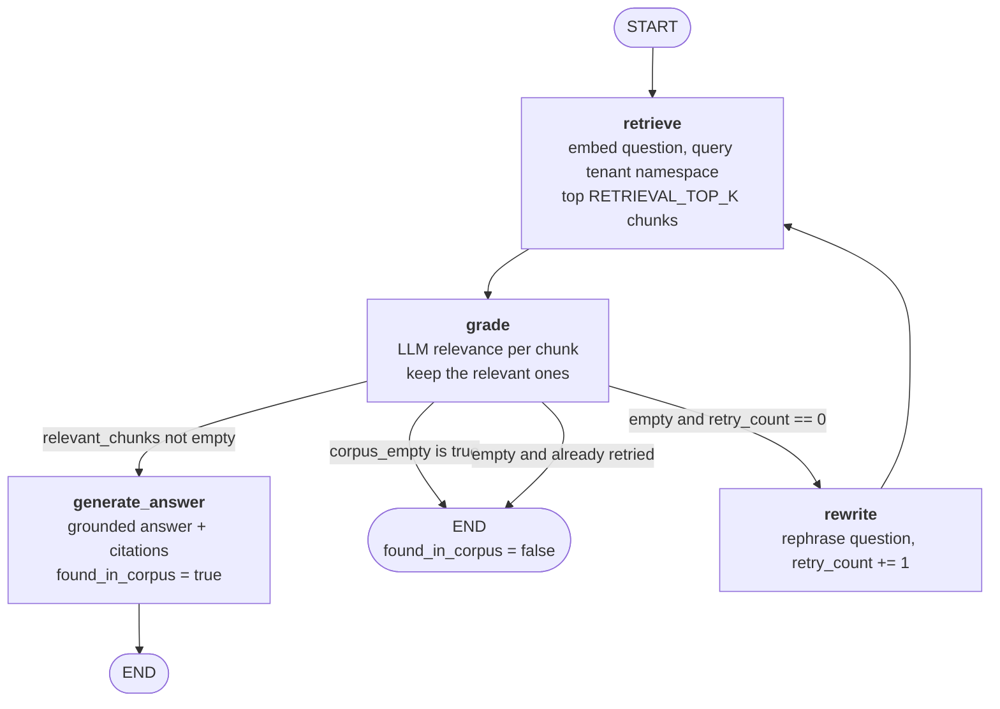

# LangGraph Workflow

The `/ask` endpoint is implemented as a compiled LangGraph **`StateGraph`**, not a single LangChain
chain. The graph is defined in `app/agents/graph_builder.py`, its state in `app/agents/graph_state.py`,
its nodes in `app/agents/nodes/`, and its routing in `app/agents/edges/conditional_edges.py`. It is
driven by `app/agents/brand_qa_agent.py::BrandQAAgent`.

---

## Graph shape



Edges (from `build_graph()`):

```python
builder.add_edge(START, "retrieve")
builder.add_edge("retrieve", "grade")
builder.add_conditional_edges(
    "grade",
    route_after_grade,
    {ANSWER_NODE: ANSWER_NODE, "rewrite": "rewrite", END: END},
)
builder.add_edge("rewrite", "retrieve")  # the retry loop
builder.add_edge(ANSWER_NODE, END)
```

## State schema

`GraphState` is a `TypedDict` with `total=False`, so every field is optional and nodes return partial
updates that LangGraph merges into the running state.

| Field | Type | Written by | Purpose |
| --- | --- | --- | --- |
| `tenant_id` | `str` | initial state | Scopes every vector query to the tenant namespace. |
| `question` | `str` | initial state | The user's original question; used for grading and for the final answer. |
| `rewritten_question` | `str` | `rewrite` | The retry question; the retrieve node prefers it when present. |
| `retrieved_chunks` | `list[RetrievedChunk]` | `retrieve` | The top-k chunks returned by the vector store. |
| `relevant_chunks` | `list[RetrievedChunk]` | `grade` | The subset the LLM marked relevant. |
| `retry_count` | `int` | initial state, `rewrite` | Starts at 0; the rewrite node increments it. Caps the loop at one retry. |
| `corpus_empty` | `bool` | `retrieve` | Distinguishes a tenant with no documents from a search that returned no matches. Prevents a pointless LLM rewrite. |
| `answer` | `str` | `generate_answer` | The grounded answer text. |
| `found_in_corpus` | `bool` | `generate_answer` / final state | `true` only when evidence was found and used. |
| `citations` | `list[Citation]` | `generate_answer` | Evidence backing the answer. |
| `trace` | `Annotated[list[TraceEntry], operator.add]` | every node | The ordered record of executed nodes. |

### The trace reducer

```python
class GraphState(TypedDict, total=False):
    ...
    trace: Annotated[list[TraceEntry], operator.add]
```

`Annotated[..., operator.add]` tells LangGraph to **merge** node outputs into this key with `+` (list
concatenation) instead of overwriting. Every node therefore returns `{"trace": [TraceEntry(...)]}` and
contributes exactly one entry without clobbering earlier ones — which is what makes the returned `trace`
a genuine record of the path the graph took (e.g. `retrieve → grade → rewrite → retrieve → grade` for a
not-found question). `BrandQAAgent.ask` returns this list verbatim in `AskResponse.trace`.

## Nodes

### `retrieve` (`app/agents/nodes/retrieve_node.py`)

- Chooses the active question: `state.get("rewritten_question") or state["question"]`.
- Calls `RetrievalService.search(tenant_id, question)`, which embeds the question and queries the
  tenant namespace for the top `RETRIEVAL_TOP_K` (default 5) chunks.
- Catches `EmptyCorpusError` (tenant has no documents) and degrades to zero chunks with the detail
  `"0 chunks retrieved (tenant has no documents)"`.
- Sets `corpus_empty=True` for that case; an empty search over a non-empty corpus leaves it `False`.
- Writes `retrieved_chunks` and appends `TraceEntry(node="retrieve", detail="N chunks retrieved")`
  (or `"0 chunks retrieved (no matches)"`).

### `grade` (`app/agents/nodes/grade_node.py`)

- Grades each retrieved chunk against the **original** question (never the rewritten one, so a rewrite
  cannot widen what counts as relevant).
- Delegates to `GradingService.grade`, which calls the LLM per chunk with `GradingDecision` structured
  output and keeps the relevant chunks.
- Writes `relevant_chunks` and appends `TraceEntry(node="grade", detail="X relevant, Y rejected")`.

### `rewrite` (`app/agents/nodes/rewrite_node.py`)

- Asks the LLM to rewrite the **original** question for better retrieval (prompt preserves intent and
  forbids inventing constraints).
- Increments `retry_count`, writes `rewritten_question`, and appends
  `TraceEntry(node="rewrite", detail="Question rewritten and retry #N scheduled")`.

### `generate_answer` (`app/agents/nodes/answer_node.py`)

- Generates a grounded answer from the relevant chunks using the original question.
- Builds citations from those chunks via `CitationService.build`.
- Writes `answer`, `citations`, `found_in_corpus=True`, and appends
  `TraceEntry(node="answer", detail="Answer generated from N relevant chunks")`.

> **Why is the answer node registered as `generate_answer`?**
> LangGraph reserves graph **state key names** as node names. The spec requires an `answer` **state
> field**, so a node literally named `answer` would collide with it. The node is therefore registered
> under the name `generate_answer` (`ANSWER_NODE = "generate_answer"`), while the trace label it writes
> is still `"answer"` — this keeps the public trace identical to the specification
> (`{"node": "retrieve" ...}, {"node": "grade" ...}, {"node": "answer" ...}`) without breaking the
> state contract.

## Conditional routing

`route_after_grade(state)` returns the next node name:

| Condition | Next | Meaning |
| --- | --- | --- |
| `state["relevant_chunks"]` is non-empty | `generate_answer` | Evidence found → answer it. |
| `state["corpus_empty"]` is true | `END` | Tenant has no documents → return not-found without an LLM retry. |
| Empty, and `retry_count == 0` | `rewrite` | No evidence yet → rewrite the question and retry once. |
| Empty, and `retry_count != 0` | `END` | Already retried → end; `found_in_corpus` stays `false`. |

```python
def route_after_grade(state: GraphState) -> str:
    if state.get("relevant_chunks"):
        return ANSWER_NODE
    if state.get("corpus_empty", False):
        return END
    if state.get("retry_count", 0) == 0:
        return "rewrite"
    return END
```

## Single-retry semantics

The workflow retries **at most once**. `retry_count` starts at `0` and is incremented by `rewrite`.
After the second `grade`:

- if relevant chunks appear, the graph answers;
- otherwise `retry_count == 1`, so `route_after_grade` returns `END` and the workflow stops with no
  answer and no citations.

This bounds LLM cost and latency, and guarantees termination (no infinite rewrite loop).

## Dependency injection into nodes

Services are not imported globally. `BrandQAAgent.build()` constructs a `GraphDependencies` object
(retrieval, grading, answer, citations) and passes it per invocation via the runnable config:

```python
config = {"configurable": {"dependencies": self._dependencies}}
final_state = await self._graph.ainvoke(initial_state, config)
```

Each node calls `dependencies_from_config(config)` to obtain them. This keeps the graph pure and makes
it trivial to supply fakes in tests.

## Final-state post-processing

After `ainvoke`, `BrandQAAgent.ask` enforces the not-found contract regardless of what the graph
produced:

```python
found = bool(final_state.get("found_in_corpus"))
answer = (final_state.get("answer") or "").strip() or NOT_FOUND_ANSWER
citations = final_state.get("citations") or []
trace = final_state.get("trace") or []
if not found:
    citations = []
    answer = NOT_FOUND_ANSWER
```

`NOT_FOUND_ANSWER = "The requested information is not available in the provided documents."`
(`app/services/citation_service.py`). When nothing is found, citations are always emptied and the answer
replaced with the constant — the service never returns an LLM answer or fabricated citation without
evidence.

---

## Related

- [ARCHITECTURE.md](ARCHITECTURE.md) — how the agent fits into the service layer stack.
- [API_DOCUMENTATION.md](API_DOCUMENTATION.md) — the `AskResponse` schema and examples.
- [DESIGN_DECISIONS.md](DESIGN_DECISIONS.md) — why LLM grading, one retry, and structured output.
